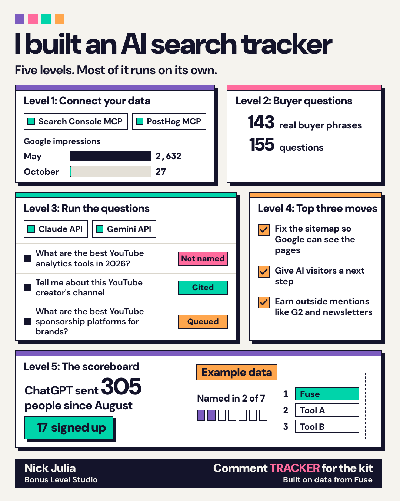

# AI Search Tracker Kit

Track which Google searches and AI answers (ChatGPT, Claude, Gemini, Perplexity) send people to your business, and get the three changes most likely to matter. You build it with Claude Code. Most of it runs on its own once it's set up.

## Why this exists

I built it for Fuse, my product, and for my B2B clients.

- Google showed Fuse in search 2,632 times in May and 27 times in October. Two clicks in the 90 days to November 1.
- Over the same stretch (August 1 to November 5), ChatGPT sent 305 people to Fuse, and 17 signed up.
- When I asked ChatGPT the buyer's question by hand ("best YouTube analytics tools in 2026"), it named five tools. Fuse wasn't one of them.

If you only watch Google, you can't see which questions name you and which ones hand the buyer to someone else. This kit tracks both.

## What's inside

| File | What it is |
|---|---|
| [`guide.md`](guide.md) | The step-by-step guide: what to connect, how to build an honest question list, how to read the results |
| [`prompts.md`](prompts.md) | 8 Claude Code prompts that build the whole tracker. Paste them in order |
| [`templates/buyer-questions-template.csv`](templates/buyer-questions-template.csv) | Buyer phrases to questions, tagged by topic and buyer stage |
| [`templates/run-log-template.csv`](templates/run-log-template.csv) | One row per AI answer: named you, cited you, who else got named |

## How it works

1. **Connect your data.** Search Console and your analytics (PostHog, Google Analytics) through MCP servers, so Claude Code pulls the numbers itself.
2. **Build the buyer questions.** From words buyers actually use: your Search Console queries, autocomplete, "People also ask", your sales calls. Then a random draw of 30, so you never pick the easy ones.
3. **Run the questions.** Through the Claude and Gemini APIs (OpenAI and Perplexity optional), several times each, on a schedule. Plus a short monthly spot check by hand in the chat apps, kept separate.
4. **Get your top three moves.** Ranked from your own data only.
5. **Read the weekly report.** What changed, with counts.

## What you need

- [Claude Code](https://claude.com/claude-code)
- Google Search Console and your analytics
- A Claude API key and a Gemini API key (kept in `.env`, never pasted into chat)
- About two hours to set up

## Start

Open Claude Code in an empty folder and paste Prompt 1 from [`prompts.md`](prompts.md).

The guide is also on the web, with updates by email: [bonuslevelstudio.com/guides/ai-search-tracker](https://bonuslevelstudio.com/guides/ai-search-tracker)

## Rather have it done for you?

I set this up for businesses: the numbers, the question panel, the automated runs, and a short read on what to change. Email nick@bonuslevelstudio.com and tell me what you sell.

Built by Nick Julia, [Bonus Level Studio](https://bonuslevelstudio.com). Built on data from [Fuse](https://getfused.io).

## License

MIT. Use it, change it, share it.
